# Object Detection API

[](https://github.com/lenohutapea/object-detection-api/actions/workflows/ci.yml)

A production-style computer vision service: send an image, get back every object in it (people, cars, buses, trucks, motorcycles and 75 more kinds) with boxes and confidence scores. Built to show the full path from a model file to a monitored, tested, containerized API.

- **Model:** YOLOX-nano exported to ONNX, run with ONNX Runtime on CPU
- **API:** FastAPI with JSON and annotated-image endpoints, input validation, OpenAPI docs
- **Observability:** Prometheus metrics for request latency, model time and detections per label
- **Delivery:** Docker image tested end to end with the real model in CI, then published to GitHub Container Registry

## Endpoints

| Method | Path | What it does |
| --- | --- | --- |
| `POST` | `/v1/detect` | Detect objects, return JSON |
| `POST` | `/v1/detect/annotated` | Detect objects, return the image with boxes drawn |
| `GET` | `/v1/labels` | The 80 labels, plus the `vehicles` group |
| `GET` | `/` | Demo page: upload an image in the browser |
| `GET` | `/docs` | Interactive API documentation |
| `GET` | `/healthz` | Liveness: the process is running |
| `GET` | `/readyz` | Readiness: the model is loaded |
| `GET` | `/metrics` | Prometheus metrics |

Both detect endpoints take the image as a `file` form field and two optional query parameters:

- `conf`: minimum confidence, 0.05 to 0.95 (default 0.35)
- `labels`: comma-separated filter such as `car,bus`, or `vehicles` for bicycle, car, motorcycle, bus and truck

### Example

```bash
curl -F "file=@street.jpg" "http://localhost:8000/v1/detect?labels=vehicles"
```

```json
{
  "model": "yolox_nano",
  "image": {"width": 1280, "height": 720},
  "inference_ms": 38.4,
  "count": 3,
  "vehicle_count": 3,
  "counts": {"car": 2, "bus": 1},
  "detections": [
    {"label": "car", "class_id": 2, "confidence": 0.8731, "box": {"x1": 412.3, "y1": 388.0, "x2": 640.9, "y2": 517.6}}
  ]
}
```

*Values above are illustrative.*

Errors come back as JSON with a clear `detail`: `400` empty file, `413` too large, `415` not an image, `422` invalid parameter or unknown label, `503` model not loaded.

## Run it

### Docker

```bash
docker build -t object-detection-api .
docker run -p 8000:8000 object-detection-api
```

Open `http://localhost:8000` for the demo page or `http://localhost:8000/docs` for the API docs. The model is downloaded into the image at build time.

### From source

```bash
python3 -m venv .venv && source .venv/bin/activate
pip install -r requirements-dev.txt
./scripts/download_model.sh
uvicorn app.main:app --reload
```

### Configuration

| Variable | Default | Meaning |
| --- | --- | --- |
| `MODEL_PATH` | `models/yolox_nano.onnx` | ONNX model file |
| `CONF_THRESHOLD` | `0.35` | default minimum confidence |
| `IOU_THRESHOLD` | `0.45` | overlap above which duplicate boxes are removed |
| `ORT_THREADS` | `1` | CPU threads per inference; keep at 1 and scale with replicas |
| `MAX_UPLOAD_MB` | `10` | upload size limit |
| `MAX_IMAGE_SIDE` | `4096` | longest allowed image side in pixels |

## How it works

```mermaid
flowchart LR
    A[Image upload] --> B[Decode and validate<br/>OpenCV]
    B --> C[Letterbox to 416x416<br/>gray padding]
    C --> D[YOLOX-nano<br/>ONNX Runtime]
    D --> E[Decode grid outputs<br/>strides 8, 16, 32]
    E --> F[Score = objectness x class<br/>threshold]
    F --> G[Non-maximum suppression<br/>per class]
    G --> H[Scale boxes back<br/>to the original image]
    H --> I[JSON or annotated JPEG]
```



The pre- and post-processing in [`app/detector.py`](app/detector.py) is written in NumPy and follows the official YOLOX ONNX Runtime demo. It is covered by unit tests that build synthetic model outputs and check box decoding, scaling, clipping and non-maximum suppression.

## Testing and CI

| Layer | Where | What it checks |
| --- | --- | --- |
| Unit | [`tests/test_detector.py`](tests/test_detector.py) | letterbox, grid decoding, NMS, score threshold, box scaling |
| API | [`tests/test_api.py`](tests/test_api.py) | every endpoint with a fake model: responses, filters, errors, metrics |
| End to end | [`scripts/smoke_test.py`](scripts/smoke_test.py) | the built image with the real model must find the dog in a sample photo |

The pipeline in [`.github/workflows/ci.yml`](.github/workflows/ci.yml) runs lint and tests, builds the image, starts it, runs the end-to-end test, and on `main` publishes the image to `ghcr.io/lenohutapea/object-detection-api`.

## Metrics

| Metric | Type | Use |
| --- | --- | --- |
| `detector_requests_total{route,status}` | counter | throughput and error rate |
| `detector_request_duration_seconds{route}` | histogram | p50 / p95 / p99 latency |
| `detector_inference_duration_seconds` | histogram | time spent in the model alone |
| `detector_objects_detected_total{label}` | counter | what the service sees, e.g. vehicles per minute |
| `detector_model_ready` | gauge | 1 when the model is loaded |

## Roadmap

- [x] ONNX inference service with FastAPI, validation and demo page
- [x] Prometheus metrics, liveness and readiness endpoints
- [x] Tests, Docker image, CI with an end-to-end model test, image publishing
- [ ] Kubernetes (k3s) deployment with probes and resource limits
- [ ] Horizontal Pod Autoscaler driven by CPU
- [ ] Load test with k6 and a Grafana dashboard for latency and scaling

## Credits

- Model: [YOLOX](https://github.com/Megvii-BaseDetection/YOLOX) by Megvii, Apache License 2.0. The pre-trained YOLOX-nano weights are trained on the COCO dataset.

## Author

**Angeleno Zuliano Hutapea** · [GitHub](https://github.com/lenohutapea) · [Portfolio](https://lenohutapea.github.io/portofolio/)
